# Panel Maestro

Un panel personal que reúne en un solo programa tus **notas, tareas, rutinas, calendario, comidas y dinero**. Se instala en
tu propio equipo, funciona sin nube ni cuentas externas y lo usas desde el navegador, también en el móvil.

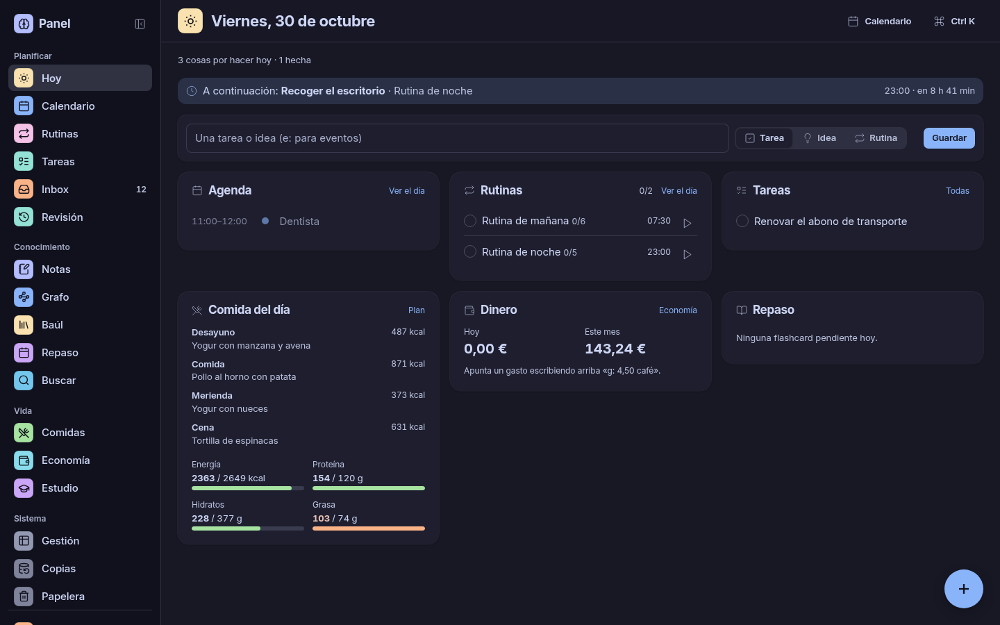

## Qué incluye

| Sección | Para qué sirve |
|---|---|
| **Hoy** | El resumen del día: lo siguiente que toca, agenda, rutinas, tareas, comida y gasto. |
| **Calendario** | Vistas de día, semana, mes y agenda. Se puede sincronizar con iCloud. |
| **Rutinas** | Tu día en bloques, con horas, días de la semana y seguimiento paso a paso. |
| **Tareas e Inbox** | Una sola lista de tareas e ideas, en lista o en cuadrícula con tarjetas que cambian de tamaño como ventanas, con prioridades, fechas y tableros para organizar proyectos. |
| **Notas** | Archivos Markdown con LaTeX, código, enlaces entre notas, flashcards y repaso. |
| **Grafo** | El mapa de cómo se relacionan tus notas. |
| **Baúl** | Enlaces y vídeos guardados, con su miniatura y por categorías. |
| **Comidas** | Ingredientes y platos con macros, generador del menú semanal y lista de la compra. |
| **Economía** | Cuentas, gastos, presupuestos, deudas, gastos fijos y lista de deseos. |
| **Rendimiento** | Registro del día en dos minutos, semáforos, reglas, exámenes y auditoría con IA gratuita ([docs/rendimiento.md](docs/rendimiento.md)). |
| **Copias** | Copias de seguridad automáticas cada noche, que se restauran desde la propia web. |

## Capturas

| | |
|---|---|
| 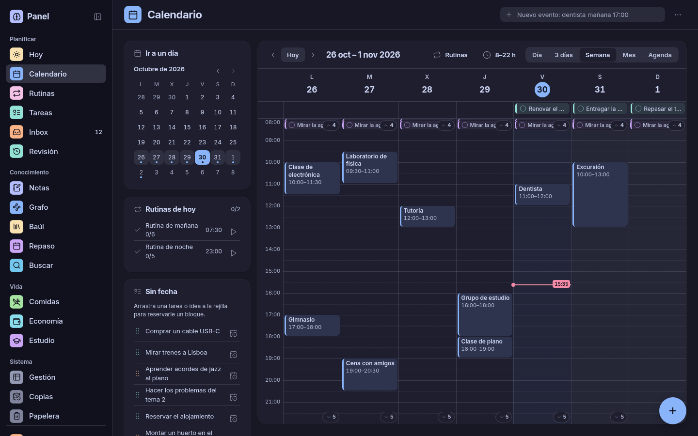 | 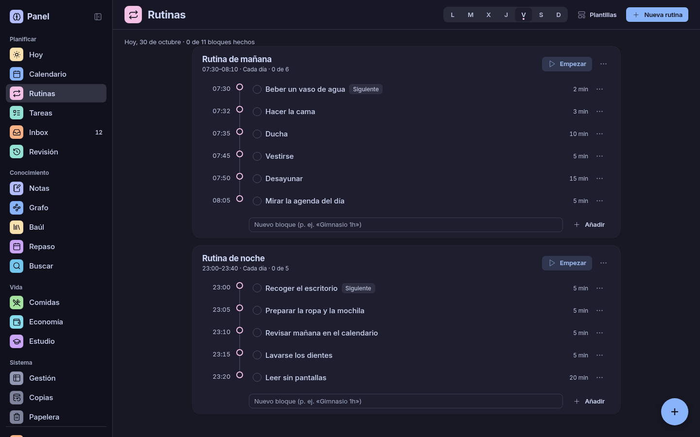 |
| **Calendario** | **Rutinas** |
| 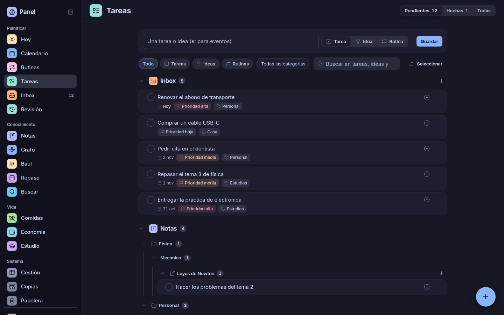 | 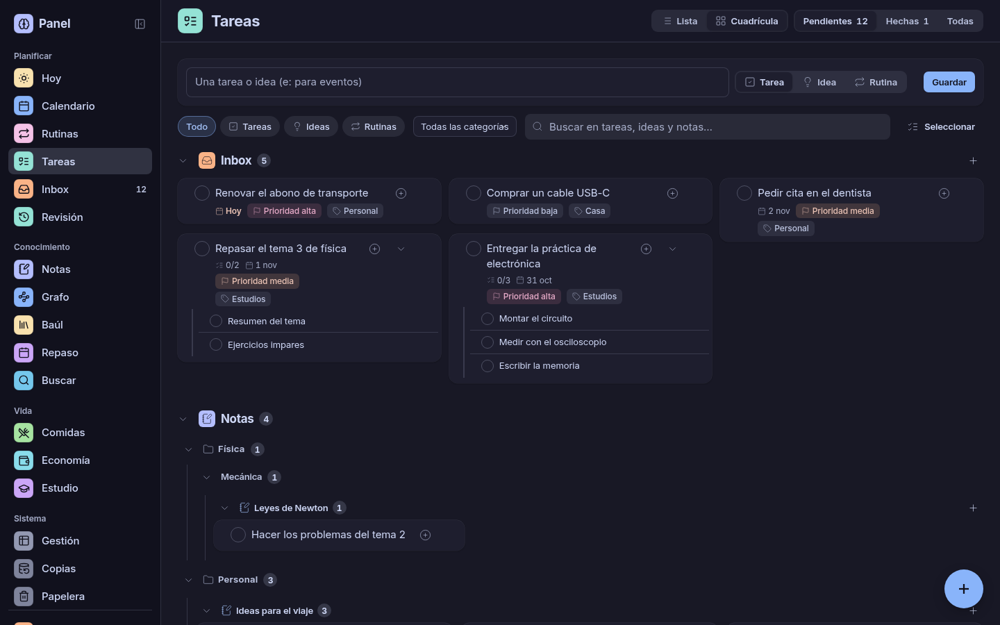 |
| **Tareas en lista** | **Tareas en cuadrícula** |
| 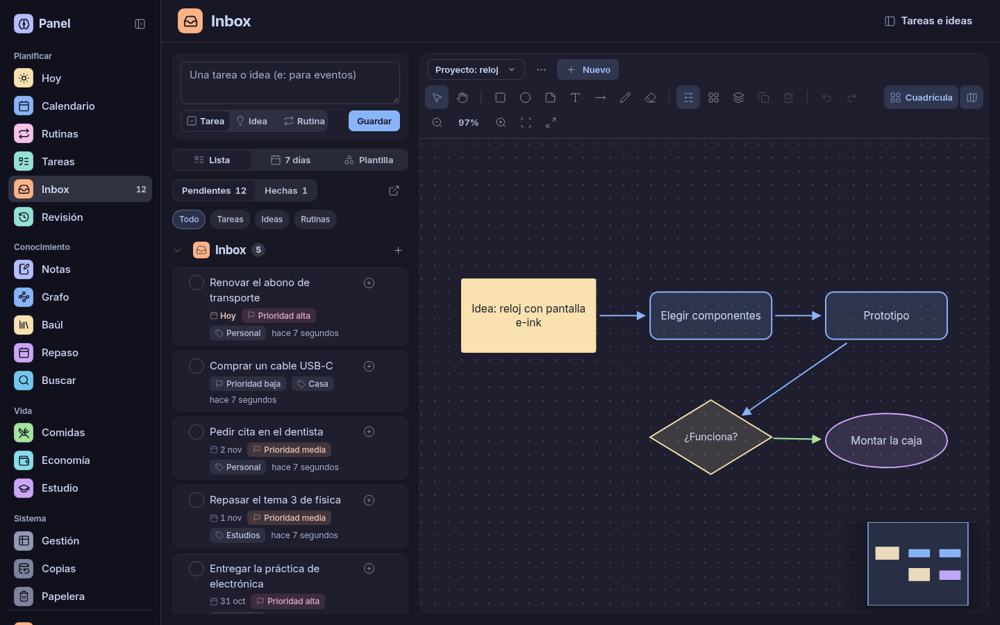 | 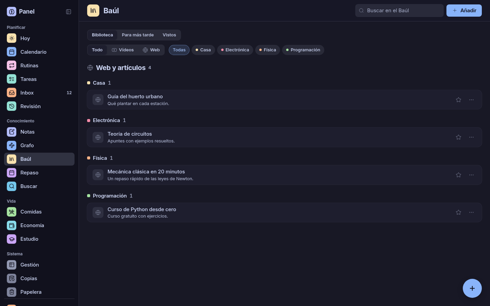 |
| **Inbox y tableros** | **Baúl** |
| 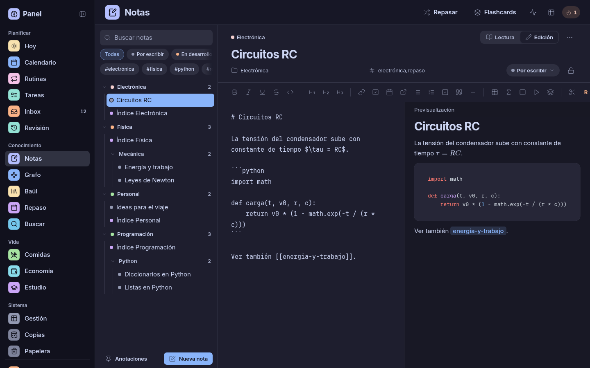 | 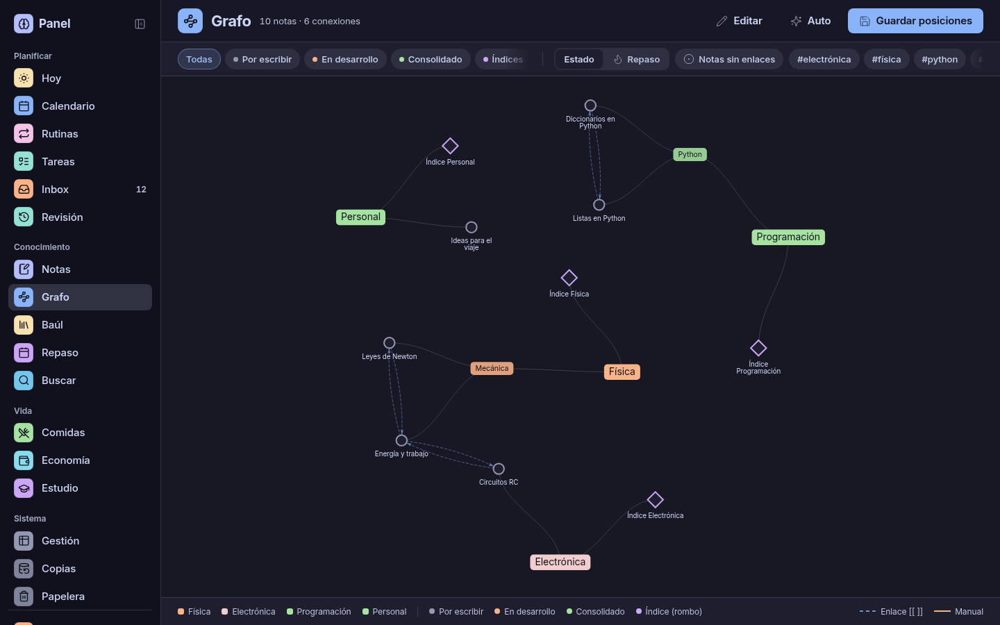 |
| **Notas** | **Grafo** |
| 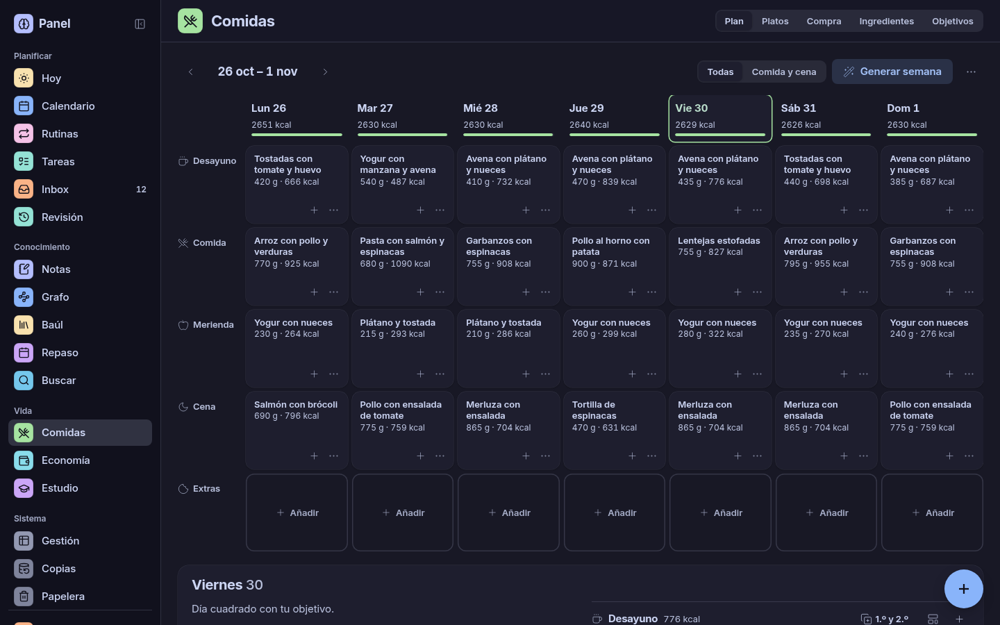 | 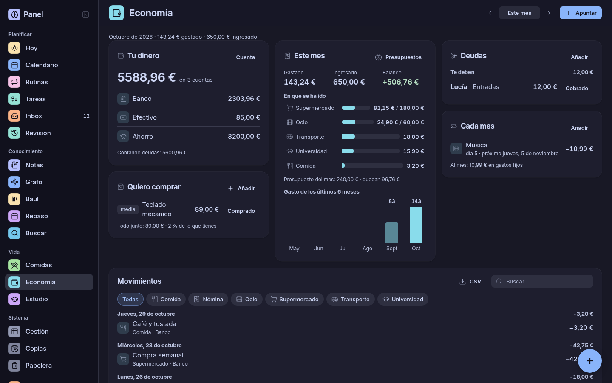 |
| **Comidas** | **Economía** |
| 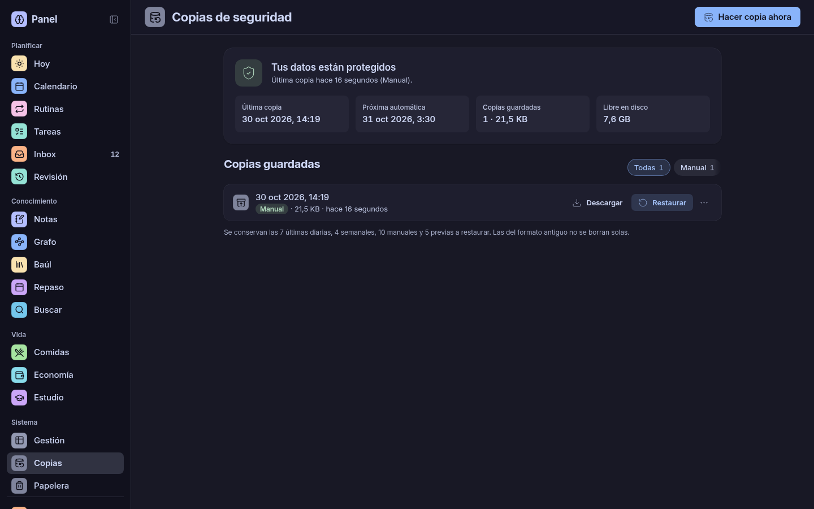 | |
| **Copias** | |

Y en el móvil, donde todo se maneja con el pulgar:

| | | |
|---|---|---|
| 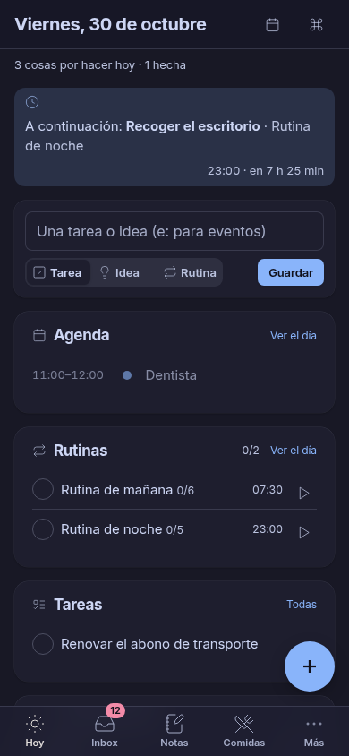 | 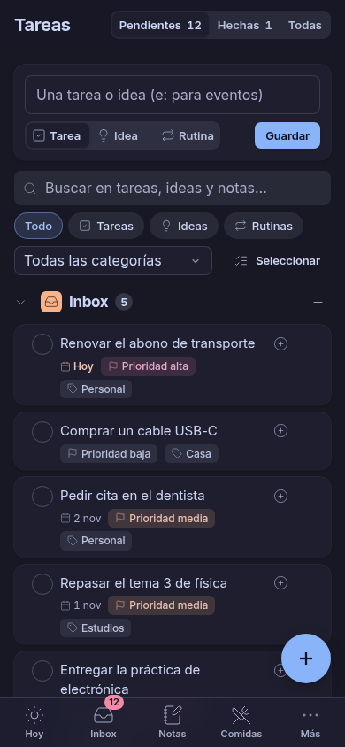 | 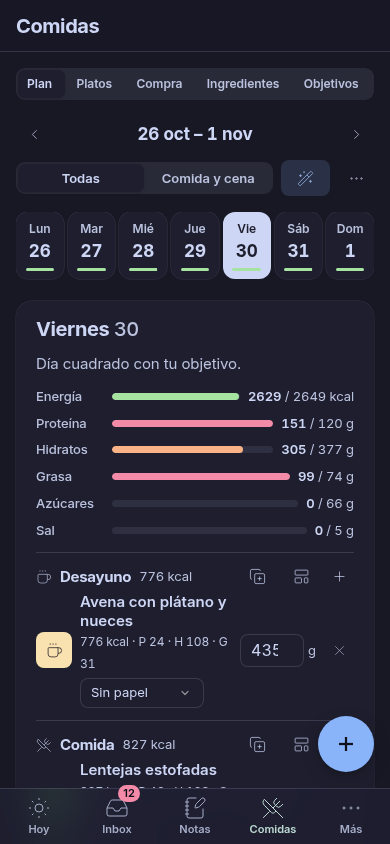 |

Las capturas usan datos inventados.

## Instalación

Necesitas Linux, `git` y Python 3.12 o superior. No hace falta Node ni base de datos: todo viene incluido.

```bash
git clone https://github.com/JoseMValeroPalomares/panel-maestro.git
cd panel-maestro
./install.sh
./start.sh
```

El instalador prepara todo y te pide una contraseña. Después abre <http://localhost:8000> y entra con ella.

El panel empieza vacío. **Para verlo con datos de ejemplo** antes de meter los tuyos:

```bash
venv/bin/python -m scripts.demo
```

Abre <http://127.0.0.1:8900>. Es una copia temporal: al pulsar `Ctrl+C` se borra y no toca tus datos.

### Que arranque solo con el equipo

```bash
./install.sh --service
```

Crea un servicio de usuario de systemd. Se gestiona con `systemctl --user restart panel-maestro`.

### Usarlo desde el móvil

El panel escucha en toda tu red local. Con el móvil en la misma wifi, abre `http://<IP-de-tu-equipo>:8000`.
Para que solo sea accesible desde tu equipo, arráncalo con `HOST=127.0.0.1 ./start.sh`.

No lo expongas directamente a internet: para entrar desde fuera de casa usa una VPN como WireGuard o Tailscale.

### Actualizar

```bash
git pull
./install.sh
```

Y reinícialo. La base de datos se actualiza sola al arrancar, pero conviene pulsar antes **Hacer copia ahora** en Copias.

## Tus datos

Todo se queda en tu equipo, en estas carpetas, y ninguna se sube a git porque están en `.gitignore`:

| Qué | Dónde |
|---|---|
| Notas (archivos `.md` normales) | `data/notes/` |
| Tareas, calendario, rutinas, economía y baúl | `data/brain.db` |
| Comidas | `comidas/data/comidas.db` |
| Imágenes subidas | `static/uploads/` |
| Copias de seguridad | `backups/` |
| Contraseña y credenciales | `.env` |

Cada noche, a las 03:30, se hace una copia completa en `backups/`. Guarda esa carpeta también fuera del equipo: si se
estropea el disco, se pierde con él. Para mover el panel a otro equipo, instálalo allí y restaura una copia desde **Copias**.

## Trucos

- **Captura con prefijos**, en cualquier caja de captura: `t: llamar al banco` (tarea), `i: app de recetas` (idea),
  `r: gimnasio lunes y jueves a las 19` (rutina), `e: dentista mañana 17:00` (evento), `g: 4,50 café` (gasto).
- **`Ctrl+K`** abre la paleta para saltar a cualquier sitio y **`?`** enseña los atajos de la página en la que estás.
- Los **temas de color** se cambian en los ajustes del panel: Catppuccin, Nord, Dracula, Gruvbox, Tokyo Night, Rosé Pine, Kanagawa, Everforest, Solarized, Papel, Alto contraste y más.

## Extras opcionales

El panel funciona completo sin nada de esto.

| Extra | Qué añade | Cómo se activa |
|---|---|---|
| **Calendario de iCloud** | Sincronización en las dos direcciones | Rellena `ICLOUD_USERNAME` e `ICLOUD_APP_PASSWORD` en `.env`, con una [contraseña de aplicación](https://account.apple.com) |
| **Extensión de Firefox** | Guardar páginas y tareas desde el navegador | [EXTENSION PANEL/README.md](EXTENSION%20PANEL/README.md) |
| **Reloj ESP32** | Pantalla de escritorio con reloj, música, calendario, pomodoro y repaso | [esp32_deskclock/README.md](esp32_deskclock/README.md) y `ESP32_HOST` en `.env` |
| **Escritorio Linux** | Captura con un atajo y agenda en la Waybar | [docs/escritorio.md](docs/escritorio.md) |
| **Dotfiles** | Subir tu configuración a GitHub desde Copias | [docs/dotfiles.md](docs/dotfiles.md) |
| **IA de Rendimiento** | Auditoría diaria y semanal con modelos gratuitos y respaldo automático | Una clave en `.env` ([docs/rendimiento.md](docs/rendimiento.md)) |

Después de cambiar `.env`, reinicia el panel. Todas las opciones están explicadas en [.env.example](.env.example).

## Si algo falla

| Problema | Solución |
|---|---|
| `No he podido crear el entorno` | En Debian y Ubuntu: `sudo apt install python3-venv` |
| `Hace falta Python 3.12 o superior` | Instala una versión nueva, o indica cuál usar: `PYTHON=python3.13 ./install.sh` |
| El puerto 8000 está ocupado | `PORT=9000 ./start.sh` |
| He olvidado la contraseña | `venv/bin/python -m scripts.set_password` y reinicia |
| No abre desde el móvil | Revisa que estén en la misma red y que el cortafuegos permita el puerto 8000 |
| Algo no funciona como debería | Mira `logs/panel.log` |

## Desarrollo

```bash
venv/bin/python -m pip install -r requirements-dev.txt
venv/bin/python -m pytest                     # nunca toca tus datos: usa un directorio temporal
venv/bin/uvicorn main:app --reload            # con recarga automática
venv/bin/python -m scripts.demo --capturas    # rehace las capturas de este README
```

Los tests de navegador necesitan Chromium: `venv/bin/playwright install chromium`; sin él, se saltan.

Está hecho con FastAPI, SQLite y JavaScript sin frameworks ni CDNs. La arquitectura se explica en [CLAUDE.md](CLAUDE.md) y el
sistema de diseño, en [DESIGN.md](DESIGN.md).

## Licencia

[MIT](LICENSE): puedes usarlo, modificarlo y compartirlo, conservando el aviso de copyright.
